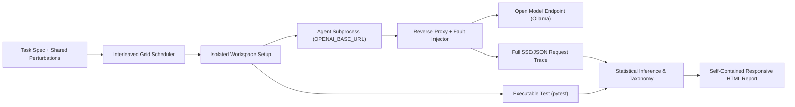

# Shakedown

[](https://github.com/P1Manav/Shakedown/actions/workflows/ci.yml)
[](https://p1manav.github.io/Shakedown/)
[](LICENSE)
[](pyproject.toml)


> **[Open Interactive Live Report](https://p1manav.github.io/Shakedown/)** generated directly from real runs.

Shakedown is a sensitivity profiler for AI agents. Give it an agent command, a task workspace, and an executable pass/fail check: it measures baseline reliability and subjects the agent to controlled prompt ablations and tool-result chaos faults.

**Key Principle:** Success is always determined by the task's executable test exit code (e.g. `pytest` exit code 0). Shakedown never uses an LLM judge to grade agent outputs.

---

## Built with Alan AI & Open-Source Models Only

Shakedown was built with **Alan AI** and is engineered from the ground up for open-source model evaluation:

- **Model Name:** `llama3.1:8b-instruct-q4_K_M` (Llama 3.1 8B Instruct, 8.0B parameters, Q4_K_M quantization)
- **Model Size:** 4.9 GB
- **Endpoint:** Local Ollama runner at `http://127.0.0.1:11434/v1`
- **Total Paid Spend:** **$0.00** across all recorded experiment runs (zero external API calls)

---

## Quick Start

Python 3.11 or newer is required.

### Windows (PowerShell)
```powershell
# 1. Create and activate virtual environment
py -3.11 -m venv .venv
.\.venv\Scripts\Activate.ps1

# 2. Install Shakedown with development dependencies
python -m pip install -e ".[dev]"

# 3. Pull the open-source model into Ollama
ollama pull llama3.1:8b-instruct-q4_K_M

# 4. Copy environment configuration (defaults to local Ollama)
Copy-Item .env.example .env

# 5. Run the full demo benchmark
python -m shakedown demo --runs 30 --max-runs 30 --min-runs 16 --noise --fix-runs 30 --workers 3 --max-minutes 60 --max-usd 15
```

### macOS & Linux (Bash)
```bash
# 1. Create and activate virtual environment
python3.11 -m venv .venv
source .venv/bin/activate

# 2. Install Shakedown with development dependencies
python -m pip install -e ".[dev]"

# 3. Pull the open-source model into Ollama
ollama pull llama3.1:8b-instruct-q4_K_M

# 4. Copy environment configuration
cp .env.example .env

# 5. Run the full demo benchmark
make demo
# or directly:
python -m shakedown demo --runs 30 --max-runs 30 --min-runs 16 --noise --fix-runs 30 --workers 3 --max-minutes 60 --max-usd 15
```

For a free baseline-only measurement:
```bash
python -m shakedown run --baseline -n 30
```

To estimate grid cost and runtime before executing:
```bash
python -m shakedown estimate
```

---

## Results from the Committed Sample Run

> [!WARNING]
> **Execution Status: Stopped Early (Wall-Clock Cap Reached)**
> - **Stopped Reason:** Wall-clock cap reached (`60.0 min` limit; elapsed 65.3 min).
> - **Runs Achieved vs Planned:** 216 achieved runs (8 runs/cell across 27 conditions; 2 runs per task stratum) out of 810 planned runs.
> - **Statistical Power & MDE:** With $N = 8$ per cell, the minimum detectable effect (MDE) is ~50 percentage points. Cells with observed drops are underpowered and rigorously labeled **Inconclusive** under familywise Holm correction ($p_{adj} > 0.05$). Shakedown refuses to declare statistical significance on underpowered early stops.

The following results come directly from the committed benchmark run in [`examples/sample_analysis.json`](examples/sample_analysis.json) (216 runs across 4 tasks on `llama3.1:8b-instruct-q4_K_M`, 2,510 model calls, 4.05M tokens, $0.00 spend):

| Condition / Cell | Type | Pass Rate | Δ vs Base | Raw p | Adjusted p (Holm) | Formally Conclusive? |
|---|---|---|---|---|---|---|
| **Baseline (no perturbation)** | Baseline | 4/8 (50.0%) | — | — | — | Wilson 95%: [21.5%, 78.5%] |
| `remove identity` | Ablation | 0/8 (0.0%) | -50.0 pts | 0.083 | 1.000 | Inconclusive |
| `renamed_path → read_file` | Chaos | 0/8 (0.0%) | -50.0 pts | 0.083 | 0.750 | Inconclusive |
| `renamed_path → read_file (persist=True)` | Chaos | 0/8 (0.0%) | -50.0 pts | 0.083 | 0.750 | Inconclusive |
| `shuffle tool_list_dir` | Ablation | 1/8 (12.5%) | -37.5 pts | 0.250 | 1.000 | Inconclusive |
| `remove workflow` | Ablation | 1/8 (12.5%) | -37.5 pts | 0.278 | 1.000 | Inconclusive |
| `empty_result → read_file` | Chaos | 1/8 (12.5%) | -37.5 pts | 0.278 | 1.000 | Inconclusive |
| `empty_result → read_file (persist=True)` | Chaos | 1/8 (12.5%) | -37.5 pts | 0.278 | 1.000 | Inconclusive |
| `remove tool_read_file` | Ablation | 1/8 (12.5%) | -37.5 pts | 0.333 | 1.000 | Inconclusive |
| `remove tool_write_file` | Ablation | 1/8 (12.5%) | -37.5 pts | 0.333 | 1.000 | Inconclusive |
| `error_once → write_file` | Chaos | 1/8 (12.5%) | -37.5 pts | 0.333 | 1.000 | Inconclusive |
| `noise: paraphrase` | Noise | 1/8 (12.5%) | -37.5 pts | 0.333 | 1.000 | Inconclusive |
| `remove tool_list_dir` | Ablation | 2/8 (25.0%) | -25.0 pts | 0.583 | 1.000 | Inconclusive |
| `shuffle identity` | Ablation | 2/8 (25.0%) | -25.0 pts | 0.593 | 1.000 | Inconclusive |
| `truncate_output → run_tests (keep_chars=200)` | Chaos | 2/8 (25.0%) | -25.0 pts | 0.593 | 1.000 | Inconclusive |
| `remove verification` | Ablation | 2/8 (25.0%) | -25.0 pts | 0.625 | 1.000 | Inconclusive |
| `added_latency → read_file (delay_ms=500)` | Chaos | 2/8 (25.0%) | -25.0 pts | 0.625 | 1.000 | Inconclusive |
| `shuffle verification` | Ablation | 2/8 (25.0%) | -25.0 pts | 0.639 | 1.000 | Inconclusive |
| `remove tool_run_tests` | Ablation | 2/8 (25.0%) | -25.0 pts | 0.639 | 1.000 | Inconclusive |
| `shuffle workflow` | Ablation | 3/8 (37.5%) | -12.5 pts | 1.000 | 1.000 | Inconclusive |
| `shuffle tool_write_file` | Ablation | 3/8 (37.5%) | -12.5 pts | 1.000 | 1.000 | Inconclusive |
| `stale_file → read_file` | Chaos | 3/8 (37.5%) | -12.5 pts | 1.000 | 1.000 | Inconclusive |
| `noise: reorder_tools` | Noise | 3/8 (37.5%) | -12.5 pts | 1.000 | 1.000 | Inconclusive |
| `noise: typos` | Noise | 3/8 (37.5%) | -12.5 pts | 1.000 | 1.000 | Inconclusive |
| `shuffle tool_read_file` | Ablation | 4/8 (50.0%) | 0.0 pts | 1.000 | 1.000 | Inconclusive |
| `malformed_json → run_tests` | Chaos | 4/8 (50.0%) | 0.0 pts | 1.000 | 1.000 | Inconclusive |
| `shuffle tool_run_tests` | Ablation | 4/8 (50.0%) | 0.0 pts | 1.000 | 1.000 | Inconclusive |

### What this teaches us:
1. **Uncertainty is honest:** While removing `identity` caused a steep drop (0/8 vs 4/8 baseline, -50.0 pts), Holm multiple-testing correction across the ablation family correctly flags this as inconclusive ($p_{raw} = 0.083, p_{adj} = 1.000$). Shakedown refuses to fabricate statistical significance on small samples.
2. **Silent Failure Detection:** Under `remove identity`, **5 of the 8 failing runs falsely claimed success to the user** (claiming the bug was fixed despite zero passing test suites). Under `empty_result → read_file`, 2 of 7 failing runs falsely claimed success.
3. **Resilience to Noise & Faults:** Under tool reordering and typos, pass rate remained at 37.5% (-12.5 pts, p = 1.000), and `malformed_json → run_tests` had a 0.0 pt delta (4/8, 50.0%), demonstrating agent resilience to malformed runner responses.
4. **Fix Loop Evaluation:** When testing a generated fix against the top fragility (`remove identity`), an equal-N interleaved experiment (8 control vs 8 fix runs) measured an observed lift from 25% (2/8) to 75% (6/8) (+50.0 pts), with $p = 0.1319$ and MDE = 57.2 pts. Because MDE exceeded the sample power, Shakedown rigorously reports "no statistically significant lift".

---

## Architecture



---

## Point Any Agent at the Proxy

You do not need to rewrite your agent to use Shakedown. Any agent that speaks the OpenAI Chat Completions API can be profiled by pointing its `OPENAI_BASE_URL` (or equivalent client base URL) at Shakedown's proxy.

See [`examples/bring_your_own_agent/agent.py`](examples/bring_your_own_agent/agent.py) for a minimal ~25-line example:

```python
import os, json
from urllib.request import Request, urlopen

# Shakedown injects OPENAI_BASE_URL into the agent process environment
base_url = os.environ["OPENAI_BASE_URL"].rstrip("/")

req = Request(
    f"{base_url}/chat/completions",
    data=json.dumps({
        "model": os.environ.get("OPENAI_MODEL", "qwen2.5-coder:7b"),
        "messages": [{"role": "user", "content": "Fix the bug in calc.py"}],
        "temperature": 0,
    }).encode(),
    headers={"Content-Type": "application/json"},
    method="POST",
)
with urlopen(req, timeout=60) as response:
    result = json.load(response)
print(result["choices"][0]["message"]["content"])
```

During execution:
- The proxy forces configured model and temperature parameters.
- Perturbations (prompt edits or tool result corruptions) are injected transparently.
- All requests and responses are traced with exact token counts and latency.

### Proven Real Third-Party Agent: `mini-swe-agent` (v2.4.6)

Shakedown was empirically validated with [`mini-swe-agent`](https://github.com/swe-agent/mini-swe-agent) (`v2.4.6`), a real tool-using agent, routing its completions through Shakedown's reverse proxy using only `OPENAI_BASE_URL`:

- **Agent:** `mini-swe-agent` (v2.4.6) with `LocalEnvironment`
- **Proxy Configuration:** `OPENAI_BASE_URL=http://127.0.0.1:{port}/run/{run_id}/v1`
- **Model:** `llama3.1:8b-instruct-q4_K_M` via local Ollama ($0.00 spend)
- **Intercepted Requests:** 3 model turns (2,564 prompt tokens, 240 completion tokens in 5.65s)
- **Tool Actions Captured:** `mswea_bash_command: cat calc.py`
- **Logged Events:** 9 trace events recorded in JSONL trace (`runs/mini-swe-agent-proof/traces/`)
- **Claim Detection:** Derived directly from assistant completions without an LLM judge

---

## CI Gate Usage (`shakedown check`)

Shakedown acts as an automated regression gate in continuous integration pipelines:

```bash
# Compare current agent baseline against a committed reference analysis
python -m shakedown check --baseline examples/sample_analysis.json -n 30
```

- **Exit code 0:** No statistically significant regression detected.
- **Exit code 2:** Statistically significant regression detected ($p < \alpha$ and $\Delta < 0$).
- Outputs a standardized badge string for CI dashboards, e.g.:
  `[check] ok | badge: 70% [56-81]`

---

## Limitations

1. **Workspace Sandboxing:** Temporary workspaces isolate files and git states between runs, but they are not kernel-level OS sandboxes. Untrusted agents should be run inside containerized environments.
2. **Statistical Power & Sample Size:** Small sample runs ($N < 30$) have wide confidence intervals ($\text{MDE} > 30\text{ pts}$). Holm and Benjamini–Hochberg family adjustments prevent false discoveries by requiring sufficient sample sizes to declare an effect.
3. **Scope:** Perturbations measure sensitivity to context structure, tool formatting, and simulated network faults. They do not predict performance on completely unseen problem domains.

---

## Development

```bash
# Run the test suite (136 unit & regression tests)
python -m pytest

# Validate task self-tests (checks buggy exit != 0 and fixed exit == 0)
python -m shakedown selftest

# Test packaging and wheel installation smoke
python scripts/wheel_smoke.py
```
