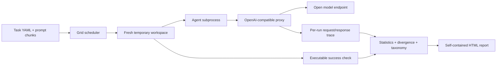

# Shakedown

Shakedown is a sensitivity profiler for AI agents. Give it an agent command, a task workspace, and an executable pass/fail check; it measures reliability and shows how controlled prompt and tool-result perturbations change the outcome.

## What it measures

- **Reliability:** repeated baseline runs with Wilson confidence intervals and trace-based first-divergence summaries.
- **Context ablation:** remove or shuffle named prompt and tool-description chunks.
- **Chaos testing:** inject truncated, empty, malformed, transient-error, stale-file, and renamed-path tool results.
- **Statistical controls:** Fisher exact fallback for small samples, Holm or Benjamini–Hochberg correction within ablation/chaos/noise families, family-adjusted confidence intervals and minimum detectable effects, and sequential stopping that allocates later runs to ambiguous cells.
- **Operational metrics:** model calls, tokens, estimated spend, steps, false success claims, and rule-based failure categories.
- **HTML report:** a self-contained, responsive sensitivity heatmap with light/dark themes, confidence intervals, divergence timeline, failure breakdown, and fix-first suggestions.

Success always comes from the task's executable check. Shakedown never asks another model to judge whether the agent succeeded.

## Quick start

Python 3.11 or newer is required. Shakedown defaults to a local Ollama endpoint, so the demo can run without paid API calls.

```powershell
py -3.11 -m venv .venv
.\.venv\Scripts\Activate.ps1
python -m pip install -e ".[dev]"
Copy-Item .env.example .env
ollama pull qwen2.5-coder:7b
make demo
```

If `make` is unavailable, run the equivalent command directly:

```powershell
python -m shakedown demo --runs 60 --max-runs 40 --min-runs 16 --workers 3 --max-minutes 60 --max-usd 15
```

The experiment output is written under `runs/` (gitignored), including `report.html`, `analysis.json`, per-run records, and full request/response traces. For a free baseline-only smoke test:

```powershell
python -m shakedown run --baseline -n 30
```

To inspect the configured worst-case grid and any automatic run-count reduction before spending time:

```powershell
python -m shakedown estimate
```

## Model and budget configuration

Copy `.env.example` to `.env`. The default model is `qwen2.5-coder:7b` served by Ollama at `http://127.0.0.1:11434/v1`. Set `MODEL_BASE_URL`, `MODEL_NAME`, and `MODEL_API_KEY` to use another OpenAI-compatible endpoint. For a priced remote endpoint, set `PRICE_INPUT_PER_1M` and `PRICE_OUTPUT_PER_1M` to that provider's current USD-per-million-token rates. Shakedown refuses an unpriced remote endpoint; set `MODEL_API_FREE=true` only when it is genuinely free.

The proxy caps output tokens, reserves estimated per-request input/output cost before forwarding, and enforces per-run and global call/spend limits. Fix reruns share the originating experiment's remaining call and spend budget rather than resetting either cap. The estimator uses a conservative request-size bound; configure accurate rates for the exact endpoint and model. Do not commit `.env` or API keys.

## Run a custom task

Each `tasks/<name>/task.yaml` declares the agent command, workspace source, success command, prompt chunks, model, and budget. The shared `tasks/perturbations.yaml` defines the experiment grid once. The runner creates a fresh temporary workspace, starts the agent with `OPENAI_BASE_URL` pointed at the proxy, waits for the agent to exit, then runs the executable success check. The proxy records each request and response under that run ID.

```yaml
agent:
  command: 'python agent.py --task {task_file} --workdir {workdir}'
  timeout_s: 240
  max_model_calls: 18
success:
  command: 'python -m pytest -q tests/'
  timeout_s: 120
```

Run a selected task or subset of cells with `python -m shakedown run --tasks bugfix_01 --cells chaos`. See `python -m shakedown run --help` for sample-size, correction, worker, and budget options.

`shakedown/model_config.py` is the source of truth for the default model name. Keep `.env.example` and the README's model setup in sync when changing it.

## Architecture



## Baseline evidence

The recorded 30-run baseline used **Qwen 2.5 Coder 7B** on local Ollama across the four included bug-fix tasks. It passed **14/30 runs (46.7%)**, with a Wilson 95% interval of **30.2–63.9%** and a **31.4-point MDE**. Per-task rates ranged from 28.6% to 62.5%. This is an observed, noisy baseline—not the aspirational 70% demo result. The 20-cell perturbation smoke test used one run per cell, so every cell remained inconclusive; it is not evidence of effects.

## Development

```powershell
python -m pytest -q
python -m shakedown selftest
```

`selftest` verifies that each benchmark's buggy implementation fails its test suite and its fixed solution passes. `BUILD_LOG.md` records checkpoints, measured costs, and limitations.

## Demo outline (about 90 seconds)

1. **0–15s:** Show the agent and executable task check; explain that success is a process exit code, not a judge model.
2. **15–35s:** Open the baseline reliability card and read the measured pass rate, Wilson interval, and MDE.
3. **35–60s:** Scan the heatmap for significant prompt/tool effects and inconclusive cells; point out raw and adjusted p-values.
4. **60–75s:** Show a failure's first-divergence step and its rule-based false-claim/taxonomy evidence.
5. **75–90s:** Apply a supported fix suggestion and compare the measured before/after rates and intervals. If no cell is significant, say so; do not manufacture a lift.

**Post draft:** “An agent can pass the task and still be fragile. Shakedown perturbs prompts and tool results, reruns executable tests, and marks uncertainty instead of calling noise a finding. The first 30-run Qwen 2.5 Coder baseline: 14/30 passes (47%, Wilson 30–64%).”

## Limitations

Temporary workspaces isolate files between runs but are not an OS-level security sandbox. Statistical power depends on the available run budget; small samples often remain inconclusive. Results describe the tested task, agent, model, and endpoint only. The bundled demo currently uses a single local open model; cross-framework proof and interaction effects are out of scope.
