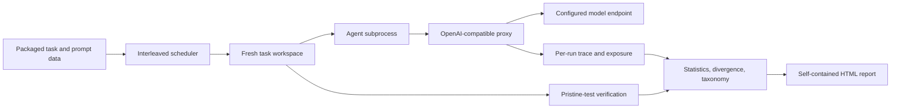

# Architecture

Shakedown runs each experiment arm in an isolated workspace and treats the task's executable check as the only success oracle.

The `src/shakedown` package contains the CLI, scheduler, runner, proxy, perturbation handlers, analysis, statistics, and report renderer. Benchmarks and prompt chunks ship as explicit package data under `src/shakedown/data`; generated experiment records remain under `./runs` or `$SHAKEDOWN_HOME/runs` and are not part of the installed distribution.

The proxy records the actual assistant tool calls and responses, applies configured perturbations, accounts for model usage, and exposes the trace to the runner. After the agent exits, the runner restores protected tests and configuration from the pristine task source before executing the success command. Analysis excludes invalid runs from pass-rate statistics and reports both intention-to-treat and exposed-run comparisons when exposure is measurable.
